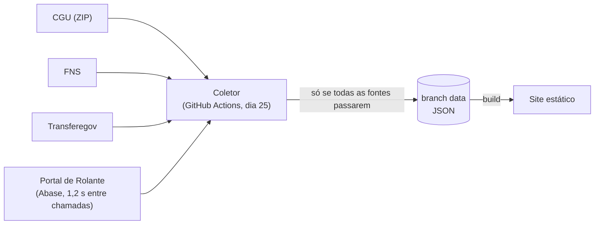

<div align="center">

<picture>
  <source media="(prefers-color-scheme: dark)" srcset="docs/brand/emendas-rolante/assets/emendas-rolante/mark-dark.svg">
  
</picture>

# Emendas Rolante

**Emendas parlamentares federais, estaduais e municipais de Rolante/RS: quem indicou, quanto chegou e o que foi feito com o dinheiro.**

[](https://github.com/filipesfbr/emendas-rolante/actions/workflows/ci.yml)


[](LICENSE)

</div>

---

## O que é

Um site que mostra as emendas enviadas a Rolante, separadas em federais, estaduais e municipais, cada uma com a
sua fonte. Os dados vêm da CGU, do Fundo Nacional de Saúde, do Transferegov e do Portal da Transparência da
Prefeitura. Site independente, sem vínculo com a prefeitura, a Câmara ou parlamentares.

> **Estado:** em desenvolvimento. Ainda sem deploy nem domínio (`emendas.rolanters.com.br`).

## Como funciona



1. Uma vez por mês (dia 25, 07:47 de Brasília) ou na mão (`workflow_dispatch`), o coletor lê as quatro fontes.
2. Fonte fora do ar, cabeçalho novo ou contagem que não fecha: a coleta falha, nada é gravado.
3. CGU: pagamentos desde 2019 aos CNPJs do Município e dos fundos (`config/fonte.json`). Detalhe (FNS,
   Transferegov, Abase): ano atual e anterior.

## Dados (branch `data`)

| Arquivo | Conteúdo |
|---|---|
| `historico.json` | pagamentos federais a Rolante desde 2019 (CGU) |
| `emendas/AAAA.json` | emendas do ano, cada fonte no seu campo |
| `manifest.json` | data da coleta, fontes, contagem por esfera e SHA-256 |

## Rodar local

Node 24.

```bash
npm ci
ANOS=2026 npm run coletar   # ~13 min; grava em ./data
npm run dev                 # http://localhost:5173, lê ./data
npm run lint && npm run build && npm test
```

## Limites conhecidos

- **Estaduais só pela prefeitura.** A fonte oficial do RS ainda está em investigação (`coletor/src/estadual.ts`).
- **Abase só tem emendas a partir de 2026.** Em 2025, só federais (CGU, FNS, Transferegov).
- **Histórico só com o que foi pago.** Empenhado sem pagamento fica fora da série da CGU.
- **Transferegov anda meses atrás da CGU.** **FNS é API interna sem documentação.**
- **Credor sem documento.** O nome só aparece quando a rubrica é de pessoa jurídica, repasse a entidade ou o
  nome tem marca de empresa (heurística em `coletor/src/abase.ts`).
- Partido diverge entre fontes: o site mostra cada um com a fonte e a data.

## Identidade visual

Família Rolante: a gota com a folha em ciclo em terracota, Inter, fundo `#faf8f4`, tinta `#26221d` e um único
acento, `#b4622f`. Tokens em [`site/src/styles/tokens.css`](site/src/styles/tokens.css); marca em
[`docs/brand/emendas-rolante/`](docs/brand/emendas-rolante/).

## Licença e créditos

Licença **MIT**, veja [`LICENSE`](LICENSE). Dados públicos da CGU, do FNS, do Transferegov e da Prefeitura
Municipal de Rolante (Abase Sistemas). Projeto independente.
