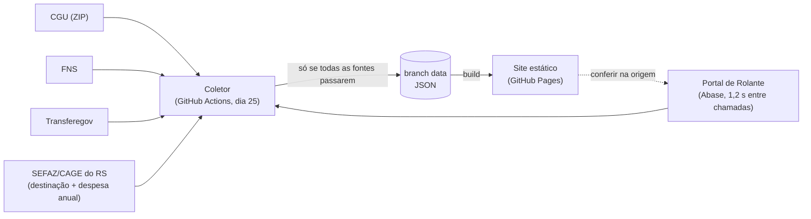

<div align="center">

<picture>
  <source media="(prefers-color-scheme: dark)" srcset="docs/brand/emendas-rolante/assets/emendas-rolante/mark-dark.svg">
  
</picture>

# Emendas Rolante

**As emendas parlamentares federais, estaduais e municipais de Rolante/RS: quem indicou, quanto chegou e o que foi feito com o dinheiro, com dados da CGU, do FNS, do Transferegov, da SEFAZ/RS e do Portal da Transparência da Prefeitura.**

[](https://github.com/filipesfbr/emendas-rolante/actions/workflows/ci.yml)


[](LICENSE)

</div>

---

## O que é

Um site que mostra as emendas enviadas a Rolante desde 2025, separadas em federais, estaduais e municipais, cada
valor com a sua fonte. Os dados vêm da [CGU](https://portaldatransparencia.gov.br/download-de-dados/emendas-parlamentares),
do [Fundo Nacional de Saúde](https://consultafns.saude.gov.br/), do
[Transferegov](https://especiais.transferegov.sistema.gov.br/), dos
[arquivos abertos da SEFAZ/RS](https://www.transparencia.rs.gov.br/emendas-parlamentares/emendas-parlamentares-estaduais/dados/)
e do [Portal da Transparência da Prefeitura de Rolante](https://transparencia.abase.com.br/home/apvqyIT7vjY=), e cada
emenda tem link para conferir na origem.

É da mesma família do [Impostômetro](https://github.com/filipesfbr/impostometro-rolante), do
[Gastômetro](https://github.com/filipesfbr/gastometro-rolante) e do
[Licitações Rolante](https://github.com/filipesfbr/licitacoes-rolante). Site independente, sem vínculo com a
prefeitura, a Câmara ou parlamentares.

> **Estado:** em desenvolvimento. Coletor e site prontos localmente; ainda sem deploy nem domínio.

## O que tem

- **Três esferas separadas:** filtro federal / estadual / municipal, cada uma com rótulo e totais próprios.
  As três nunca são somadas num «total trazido».
- **Cartão de cada emenda:** autor, partido (com a fonte), objeto, valor indicado, o que chegou e o que a
  prefeitura já pagou. Emenda municipal sempre com o selo «Orçamento do próprio município. Não é dinheiro novo.»
  e sem «já pagou» (ver limites).
- **Página de cada emenda:** pagamentos da União (CGU), proposta do FNS, plano da emenda Pix, destinação e
  despesa do Estado (SEFAZ/CAGE) e, no portal da prefeitura, a entrada na conta, os empenhos, os credores e a
  licitação, com link para o [Licitações Rolante](https://licitacoes.rolanters.com.br/).
- **Emendas estaduais a entidades:** as que vão direto para hospital, escola ou clube aparecem com o destino, mesmo
  sem passar pela prefeitura.
- **Alerta de parada ou atrasada:** o fato que a fonte registra, sempre com o aviso dos 36 meses da emenda Pix.
- **O que é emenda?:** um texto curto por esfera, dizendo quem indica e de onde sai o dinheiro.

## Como funciona



1. Uma vez por mês (dia 25, 07:47 de Brasília) ou na mão (`workflow_dispatch`), o coletor lê as cinco fontes,
   de 2025 (`anoMinimo` em [`config/fonte.json`](config/fonte.json)) até o ano atual.
2. **Federal:** pagamentos da CGU aos CNPJs do Município e dos fundos, casados com o FNS, o Transferegov e a Abase
   pelo código de 12 dígitos da emenda.
3. **Estadual:** o CSV de destinação da SEFAZ (~200 KB), filtrado por `CodMunicipio = 103`, casado com a despesa
   anual do Estado (~142 a 180 MB por ano, lida em streaming) e com a Abase por **Ano + nº da emenda**.
4. **Municipal:** o módulo de emendas do portal da prefeitura (só existe a partir de 2026).
5. Fonte fora do ar, cabeçalho novo ou contagem que não fecha: a coleta falha e nada é gravado (R2). CPF e dados
   bancários nunca são gravados (R8).

## Dados

Na branch `data`, gerada pelo coletor (não fica na `main`):

| Arquivo | Conteúdo |
|---|---|
| `historico.json` | pagamentos federais a Rolante desde 2025, por mês (CGU) |
| `emendas/AAAA.json` | emendas do ano, cada fonte no seu campo (`cgu`, `fns`, `transferegov`, `rs`, `abase`) |
| `manifest.json` | data da coleta, recorte, fontes, contagem por esfera e SHA-256 de cada arquivo |

| Pasta | O quê |
|---|---|
| `coletor/` | um módulo por fonte, junção das fontes e testes |
| `config/` | `fonte.json`: recorte, CNPJs, endereços e o token público do portal |
| `site/` | o site, em Vite + React |
| `docs/` | regras da fonte de verdade e o pacote de marca (`docs/brand/`) |

## Stack

| Camada | Tecnologia |
|---|---|
| Site | React 19, Vite 8, TypeScript strict, Inter local |
| Coletor | Node 24 (roda TypeScript direto), sem build, `unzip` do sistema |
| Dados | JSON na branch `data` |
| Deploy | GitHub Pages |
| CI e coleta | GitHub Actions, `ci.yml` e `coleta.yml` |

## Rodar local

Node 24.

```bash
npm ci
npm run coletar    # ~40 min (a despesa do RS baixa devagar); grava em ./data
npm run dev        # http://localhost:5173, lê ./data
```

Para coletar só um ano do recorte: `ANOS=2026 npm run coletar`.

Antes de abrir PR (é o que o CI roda):

```bash
npm run lint && npm run build && npm test
```

## Limites conhecidos

- **Só 2025 em diante.** Recorte decidido em 23/11/2026; muda em `anoMinimo` (`config/fonte.json`).
- **Federal só com o que foi pago.** Empenhado sem pagamento fica fora da CGU; o «liquidado» federal destinado a
  Rolante não existe em nenhuma fonte.
- **Abase só tem emendas a partir de 2026.** Em 2025 não há o uso pela prefeitura, só o que as outras fontes dão.
- **Despesa do RS é pesada e lenta.** São ~320 MB por coleta (2025 + 2026), a ~200 KB/s em 23/11/2026. O arquivo
  anual é o único completo: o CKAN de dados.rs.gov.br não tem DataStore e os mensais de 2026 têm meses vazios.
- **Transferegov anda meses atrás da CGU.** **FNS é API interna sem documentação.**
- **Credor sem documento.** Na prefeitura, o nome só aparece quando a rubrica é de pessoa jurídica, repasse a
  entidade ou o nome tem marca de empresa (heurística em `coletor/src/abase.ts`). No Estado, só com CNPJ.
- **Municipal sem valor pago por emenda.** O portal liga à emenda municipal os empenhos da dotação inteira (o
  mesmo empenho de R$ 1.287.000 aparece nas 9 emendas de R$ 143.000 à Fundação Hospitalar) e nada separa a parte
  dela. O site lista esses empenhos com esse aviso e não soma nada (R9).
- **Partido diverge entre fontes** (ex.: Elizandro Sabino, Republicanos na Abase e PRD no RS): o site mostra cada
  um com a fonte e a data.

## Identidade visual

Família Rolante: a gota com a folha em ciclo em terracota, fonte Inter, fundo `#faf8f4`, tinta `#26221d` e um
único acento, `#b4622f` (âmbar `#d98a52` no tema escuro). Sem sombras nem gradientes. Os tokens ficam em
[`site/src/styles/tokens.css`](site/src/styles/tokens.css), a marca entra pelos componentes de
[`site/src/components/brand/`](site/src/components/brand/), e os arquivos da marca estão em
[`docs/brand/emendas-rolante/`](docs/brand/emendas-rolante/).

## Licença e créditos

Licença **MIT**, veja [`LICENSE`](LICENSE). Os dados são públicos e pertencem às fontes: CGU (Portal da
Transparência), Fundo Nacional de Saúde, Transferegov, SEFAZ/CAGE do Rio Grande do Sul e Prefeitura Municipal de
Rolante (Abase Sistemas). Projeto independente, sem vínculo com a prefeitura.
